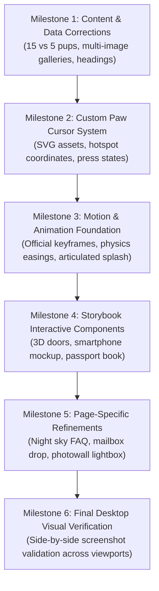

# TeddyPups UAE — Comprehensive Desktop Reference Audit & Reconstruction

**Audit Date:** 2026-11-01  
**Target Platform:** Desktop Only (1440 × 900 primary, 1366 × 768 secondary, 1600 × 900 additional)  
**Live Reference:** https://puppy.instabizweb.com/  
**Local Build:** http://localhost:5173/  
**Associated Artifacts:**
- [`CURSOR_RECREATION.md`](file:///d:/Rish/Projects/TeddyPupsUAE/CURSOR_RECREATION.md)
- [`ANIMATION_INVENTORY.md`](file:///d:/Rish/Projects/TeddyPupsUAE/ANIMATION_INVENTORY.md)
- Screenshots: `audit_screenshots/reference/` and `audit_screenshots/local/`

---

## 1. Executive Summary

This comprehensive desktop reference audit compares the live reference website ([puppy.instabizweb.com](https://puppy.instabizweb.com/)) directly against the current local implementation ([localhost:5173](http://localhost:5173/)). 

While the local project successfully scaffolds all 8 routes and basic content structure, deep inspection of the live DOM, computed stylesheets, and browser interactions reveals that the live reference is built around a distinct **storybook & physical-toy design language** featuring custom hardware-accelerated CSS paw cursors, 46 specialized CSS animation keyframes, 3D perspective card mechanics, simulation widgets (including an interactive smartphone and passport notebook), and multi-image galleries.

This audit establishes an evidence-based roadmap to bring the desktop experience from an approximate recreation to an indistinguishable desktop clone.

---

## 2. Core Reference Website Architecture & Discoveries

1. **Framework & Design System:**
   - The reference is built with Next.js and Tailwind CSS (v4) using custom `tp-` class namespaces (over 549 distinct `tp-` utility and component rules).
   - Core fonts confirmed from Google Fonts:
     - `Fraunces` (`font-plush`, display serif headings)
     - `Shantell Sans` (`font-scrawl`, handwritten annotations and tags)
     - `Figtree` (`font-sans`, clean geometric body font)
2. **Custom Paw Cursor System:**
   - Implemented natively via standard CSS `cursor: url('/cursor/paw.svg') 9 6, auto;` and interactive press state `cursor: url('/cursor/paw-press.svg') 9 6, pointer;`.
   - Zero JavaScript mouse-lag, 60+ FPS hardware compositor rendering, with an intentional tactile "press" effect on hover over clickable elements.
3. **Motion & Animation Architecture:**
   - Contains **46 discrete CSS keyframes** and 34 specialized animation binding rules.
   - Distinct physics curves: `var(--ease-pounce)` (`cubic-bezier(0.34, 1.56, 0.64, 1)`) for lively bounce, and `var(--ease-snap)` (`cubic-bezier(0.22, 1, 0.36, 1)`) for quick physical response.
4. **Data Reality Check — Available vs Gone Home Puppies:**
   - On the `/puppies` page, the live reference displays **15 available puppies** under the heading `"15 puppies looking for a home"`.
   - A separate lower section titled `"Already gone home"` displays **5 recently adopted alumni** (Ace, Leo, Mia, Sadie, and Blue Merle Pomeranian) with `"gone home ♥"` badges.
   - The local build erroneously renders all 20 puppies as active available inventory in a single grid.
5. **Puppy Detail Image Galleries:**
   - Reference puppy profiles contain **5 to 14 gallery photos** per puppy, not single static hero shots.
6. **Unique Toy & Storybook Component Motifs:**
   - **"Meet the pups" Doors:** Interactive wooden doors (`.tp-door`) with doorplates, peepholes, and knobs that swing open in 3D perspective (`rotateY(-102deg)`) on hover to reveal the puppy inside.
   - **"Your puppy journey" Smartphone Mockup:** An interactive iPhone frame showing simulated WhatsApp messages, green typing dots, breed chips, and video clip previews.
   - **"Why families trust TeddyPups" Passport Book:** Vintage passport layout with stamped visa-style guarantee badges.
   - **"Happy families" Photowall:** Hanging Polaroid prints with realistic washi tape strips at varied natural tilt angles.
   - **"Contact" Airmail Stationery & Outgoing Postbox:** Interactive letterform that folds in 3D perspective and posts into a red mailbox with a rising flag on submission.

---

## 3. Route-by-Route Comparison & Discrepancies

### A. Homepage (`/`)

| Section / Element | Reference Website | Local Implementation | Discrepancy & Visual Impact | Priority |
| :--- | :--- | :--- | :--- | :--- |
| **Custom Paw Cursor** | Tilted paw cursor (`9 6` hotspot), changes to pressed paw on hover | System default arrow & pointer | Missing signature playful interaction across entire site | **P1** |
| **Intro Curtain Splash** | Articulated running cartoon puppy (legs, wagging tail, bobbing ears) with trailing paw prints | Static puppy icon with simple fade-out curtain | Lacks character personality and animated trotting motion | **P1** |
| **Hero Section Composition** | Arched rising sun (`tp-hero__sun`), 6-seat puppy carousel with arched portraits and handwritten scrawl tags below | Arched 3-image preview with static layout | Missing the rising sun animation, carousel line-up, and scrawl name tags | **P1** |
| **Meet the Pups Section** | Hallway of interactive 3D wooden doors (`tp-door`) that swing open on hover | Standard 4:3 card grid | Completely missing the signature 3D door reveal mechanic | **P0** |
| **Two Ways to Meet Pathways** | Left: Dubai showroom window + skyline SVG; Right: International flight route + animated floating airplane SVG | Two basic comparison cards with bullet lists | Missing the illustrated window scene and animated flight route graphic | **P1** |
| **Your Puppy Journey Timeline** | Left: 3 concise steps; Right: Interactive iPhone mockup with live WhatsApp conversation & breed chips | Vertical 3-step text cards | Missing the interactive smartphone conversation mockup | **P0** |
| **Trust & Guarantees** | Open vintage "puppy passport" notebook with rubber-stamped circular and ticket seals | 4 grid cards with Lucide icons | Missing the physical passport book motif and animated stamp impressions | **P1** |
| **Happy Families Preview** | Corkboard wall of tilted Polaroids with translucent washi tape strips + client quote card | Grid of white cards with drop shadows | Polaroids lack natural tilt angles and tape aesthetics | **P2** |
| **FAQ Preview (Night Sky)** | Dark chocolate night scene with 11 pulsating animated twinkles (`tp-twinkle`) + mascot question mark | Corkboard card with pushpin styling | Section should be a whimsical starry night sky, not corkboard | **P1** |
| **Welcome Home Cottage CTA** | Illustrated cottage doorway with porch lamp, house plants, and welcome mat in scrawl | Standard rectangular honey callout box | Missing the illustrated cottage entrance motif | **P1** |

---

### B. Available Puppies Listing (`/puppies`)

| Section / Element | Reference Website | Local Implementation | Discrepancy & Visual Impact | Priority |
| :--- | :--- | :--- | :--- | :--- |
| **Available Inventory Count** | Exactly **15 available listings** under heading `"15 puppies looking for a home"` | 20 available listings in main grid | 5 alumni puppies are incorrectly presented as active inventory | **P0** |
| **Already Gone Home Section** | Secondary section at bottom titled `"Already gone home"` featuring 5 adopted alumni | Banner linking to `/gone-home` without puppy cards | Missing the 5 alumni cards with `"gone home ♥"` badges | **P0** |
| **Filter Button Options** | Filters: `Everywhere`, `Imported`, `Korean Teacup`, `Maltipoo`, `Pomeranian`, `Poodle`, `Cavapoo`, `Shih Tzu` | Filters: `All`, `In Dubai`, `Imported` + separate breed pills | Reference combines location and breed into a single unified pill bar | **P2** |
| **Puppy Card Layout** | Card featuring arched photo crop, badge tag, name in `Fraunces`, sub-meta, and video icon | Card with rectangular 4:3 aspect ratio | Shape and badge positioning differ from reference cards | **P2** |
| **Card Hover Effect** | Subtle card lift with spring easing (`var(--ease-pounce)`) | Standard CSS lift | Easing curve is slightly stiffer than reference spring | **P3** |

---

### C. Puppy Detail Pages (`/puppies/:slug`)

| Section / Element | Reference Website | Local Implementation | Discrepancy & Visual Impact | Priority |
| :--- | :--- | :--- | :--- | :--- |
| **Photo Gallery Length** | **5 to 14 high-resolution photos** with interactive thumbnail navigation | Single main hero image | Users cannot browse additional photos of the puppy | **P0** |
| **Breadcrumbs Structure** | `Available puppies / [Name]` (or `Gone home / [Name]` for alumni) | `Home > Available puppies > [Name]` with chevron icons | Styling and link text structure differs | **P2** |
| **Alumni Puppy State** | If puppy is adopted, displays `"gone home ♥"` status with congratulations banner | Displays standard inquiry form regardless of adoption status | Critical content discrepancy for alumni records | **P0** |
| **Related Puppies Showcase** | 3 contextual puppy cards matching breed or origin | 3 arbitrary puppies | Needs consistent matching logic | **P2** |
| **Inquiry Actions** | Direct WhatsApp CTA with customized message and pre-filled inquiry text | WhatsApp CTA + generic contact form button | Primary CTA alignment and spacing adjustments | **P2** |

---

### D. Gone Home Alumni (`/gone-home`)

| Section / Element | Reference Website | Local Implementation | Discrepancy & Visual Impact | Priority |
| :--- | :--- | :--- | :--- | :--- |
| **Boarding Pass Motif** | Vintage flight ticket with perforated stub, flight route arrow, and luggage tag string | Perforated ticket card with circular photo | Visual styling is close, but lacks swinging tag animation (`tp-tag-swing`) | **P1** |
| **Tag Swing Animation** | Luggage tag gently swings like a pendulum on scroll entry (`-7deg` → `+4deg` → `0`) | Static tag badge | Missing physics-based pendulum entrance | **P1** |
| **Total Records** | Exactly 27 alumni boarding passes verified | 27 alumni boarding passes present | Content matches verified records | **P3** |

---

### E. Happy Families Testimonials (`/happy-families`)

| Section / Element | Reference Website | Local Implementation | Discrepancy & Visual Impact | Priority |
| :--- | :--- | :--- | :--- | :--- |
| **64 Moments Lightbox** | Each Polaroid has accessible button trigger (`Open photo X of 64`) that opens modal lightbox | Static Polaroid images in masonry/grid | Clicking Polaroids does not open full-size image lightbox | **P1** |
| **Washi Tape Aesthetics** | Translucent washi tape strips with varied positions: `center`, `left`, `right`, `tl` (top-left), `tr` (top-right) | Fixed tape strips | Tape variety should match reference coordinates and natural tilt | **P2** |
| **Sarah M. Pinned Note** | Prominently pinned client letter card with warm paper texture | Pinned note exists | Texture and typography weight adjustments needed | **P3** |

---

### F. How It Works (`/how-it-works`)

| Section / Element | Reference Website | Local Implementation | Discrepancy & Visual Impact | Priority |
| :--- | :--- | :--- | :--- | :--- |
| **Two Ways Switcher** | Segmented tab switcher with physical pill indicator: `In Dubai (meet in person)` vs `Imported (order upon request)` | Interactive switcher implemented | Switcher works, but needs transition timing alignment (`var(--ease-snap)`) | **P2** |
| **Adoption Timelines** | Detailed step-by-step illustrations with delivery options and cargo icons | Text timeline cards | Missing cargo airline and delivery vehicle graphic accents | **P2** |

---

### G. FAQ Page (`/faq`)

| Section / Element | Reference Website | Local Implementation | Discrepancy & Visual Impact | Priority |
| :--- | :--- | :--- | :--- | :--- |
| **Page Heading** | `"Questions & answers"` | `"Frequently Asked Questions"` | Copy differs from reference heading | **P1** |
| **Night Sky Background** | Dark chocolate background with starry twinkles (`.tp-night`) and floating mascot | Corkboard background with multi-colored pushpins | Visual theme differs from reference page design | **P1** |
| **Accordion Animation** | Smooth spring expansion using `var(--ease-pounce)` with subtle question icon rotation | Standard CSS height transition | Easing curve and star icon rotation adjustments | **P2** |

---

### H. Contact & Showroom (`/contact`)

| Section / Element | Reference Website | Local Implementation | Discrepancy & Visual Impact | Priority |
| :--- | :--- | :--- | :--- | :--- |
| **Page Heading** | `"Get in touch with us"` | `"Visit & Contact"` | Copy differs from reference heading | **P1** |
| **Submit Button Text** | **`"Post my letter"`** | `"Send letter to TeddyPups"` | Copy differs from reference CTA | **P1** |
| **Letterfold Submission Animation**| 3D letter fold (`tp-letter-fold`) → envelope insertion (`tp-env-in`) → postbox deposit (`tp-env-post`) → flag rises (`tp-flag`) | Instant text message banner | Missing the physical animated postbox mailing sequence | **P1** |
| **Showroom Details** | Address, hours, and map link in Downtown Dubai | Present | Accurately matches reference information | **P3** |

---

## 4. Comprehensive Priority Comparison Matrix

| # | Element / Feature | Reference Implementation | Local Implementation | Difference | Priority |
| :---: | :--- | :--- | :--- | :--- | :---: |
| 1 | **Available Puppies Count** | 15 available listings under "15 puppies looking for a home" | 20 listings in main grid | 5 adopted puppies incorrectly placed in active inventory | **P0** |
| 2 | **Alumni Showcase on `/puppies`** | Separate lower section "Already gone home" with 5 cards | Missing section (only has banner to `/gone-home`) | Missing 5 alumni puppy cards with "gone home ♥" tags | **P0** |
| 3 | **Puppy Detail Photo Galleries** | 5 to 14 gallery photos per puppy with thumbnail navigator | Single main photo per puppy | Missing additional 4–13 gallery photos per puppy | **P0** |
| 4 | **Meet the Pups 3D Doors** | Interactive wooden doors swinging open in 3D (`rotateY`) | Static cards | Missing the signature 3D perspective door opening mechanic | **P0** |
| 5 | **Puppy Journey Smartphone** | Realistic iPhone mockup with animated WhatsApp thread | Plain 3-step text cards | Missing simulated smartphone conversation widget | **P0** |
| 6 | **Custom Paw Cursor** | Native CSS cursor with `paw.svg` & `paw-press.svg` (`9 6` hotspot) | Standard browser default arrow/pointer | Missing signature brand cursor experience | **P1** |
| 7 | **Trotting Puppy Splash** | Articulated runner (moving legs, wagging tail, trailing paw prints) | Simple static icon scale/fade | Missing runner articulation and step-by-step prints | **P1** |
| 8 | **Hero Rising Sun & Arches** | Sun rises behind horizon (`tp-sunrise`), 6-seat puppy lineup | Static arch gallery | Missing animated sun rise and scrawl name tags | **P1** |
| 9 | **Two Ways Pathway Illustration** | Illustrated Dubai skyline + window & airplane on flight path | 2 plain feature cards | Missing vector skyline and animated airplane graphic | **P1** |
| 10 | **Puppy Passport Guarantees** | Open passport book with stamped rubber seals (`tp-stamp-in`) | Standard 4-card feature list | Missing open passport book styling and stamp animations | **P1** |
| 11 | **Happy Families Lightbox** | Accessible button triggers opening full-screen modal lightbox | Static image cards | Clicking Polaroids does not open modal gallery | **P1** |
| 12 | **FAQ Starry Night Scene** | Dark sky with 11 rotating twinkles (`tp-twinkle`) + wondering mascot | Corkboard pushpin styling | Wrong visual theme (night sky vs corkboard) | **P1** |
| 13 | **Contact Postbox Submission** | 3D letter fold, envelope slide, mailbox deposit & rising flag | Text alert banner | Missing signature animated postal drop sequence | **P1** |
| 14 | **Contact Page H1 & Button** | H1: "Get in touch with us", Button: "Post my letter" | H1: "Visit & Contact", Button: "Send letter..." | Heading and button text discrepancies | **P1** |
| 15 | **FAQ Page Heading** | H1: "Questions & answers" | H1: "Frequently Asked Questions" | Heading copy discrepancy | **P1** |
| 16 | **Luggage Tag Swing Animation** | Boarding pass luggage tag swings like a pendulum (`tp-tag-swing`)| Static tag badge | Missing physics-based pendulum entrance | **P1** |
| 17 | **Unified Puppy Filter Bar** | Single row: Everywhere, Imported, Korean Teacup, Maltipoo... | Two rows: Where pills + Breed pills | Layout and pill categorization difference | **P2** |
| 18 | **Polaroid Natural Tilt & Tape** | Varied natural tilt angles (`-3deg` to `+3deg`) + 5 tape positions | Uniform tilt angles | Missing subtle organic variation in tilt and tape | **P2** |
| 19 | **Puppy Detail Breadcrumbs** | `Available puppies / [Name]` or `Gone home / [Name]` | `Home > Available puppies > [Name]` | Breadcrumb syntax and route label differences | **P2** |
| 20 | **Motion Easing Alignment** | Exact `var(--ease-pounce)` and `var(--ease-snap)` curves | Standard CSS ease-in-out / silk | Physics feel slightly less springy than reference | **P2** |

---

## 5. Ranked Top 20 Highest-Impact Improvements

1. **Recreate the Custom Paw Cursor (`P1`):** Add `public/cursor/paw.svg` and `public/cursor/paw-press.svg` with native CSS hotspot rules (`9 6`) across `html`, `body`, and interactive targets.
2. **Correct Available Inventory Count on `/puppies` (`P0`):** Separate active available listings (15 puppies) from recently adopted alumni (5 puppies) under `"15 puppies looking for a home"`.
3. **Build the "Already Gone Home" Showcase on `/puppies` (`P0`):** Add the lower section showcasing the 5 adopted puppies (Ace, Leo, Mia, Sadie, Blue Merle) with `"gone home ♥"` badges.
4. **Implement Multi-Image Puppy Detail Galleries (`P0`):** Expand puppy profiles from 1 image to full galleries (5–14 images) with interactive thumbnail carousel navigation.
5. **Recreate the "Meet the Pups" 3D Doors (`P0`):** Implement the `.tp-door` component with 3D perspective swing (`rotateY(-102deg)` on hover), doorplate, peephole, and knob.
6. **Recreate the "Your Puppy Journey" Smartphone Mockup (`P0`):** Implement the iPhone frame widget with simulated WhatsApp conversation, live typing dots, and clickable breed chips.
7. **Recreate the Articulated Trotting Puppy Splash Animation (`P1`):** Build the runner with independent leg swing cycles (`tp-runner-leg-a/b`), tail wag, ear bounce, and trailing paw prints.
8. **Recreate the Hero Rising Sun & Puppy Line-Up (`P1`):** Add the rising sun animation (`tp-sunrise`), arched puppy carousel, and handwritten scrawl tags.
9. **Implement the "Why Families Trust TeddyPups" Passport Book (`P1`):** Redesign the trust section as an open passport notebook with animated ink stamp impressions (`tp-stamp-in`).
10. **Implement 3D Letterfold & Mailbox Animation on Contact (`P1`):** Build the multi-phase form submission sequence: letter folding, envelope insertion, mailbox drop, and rising flag.
11. **Align FAQ Theme to Starry Night Sky (`P1`):** Update `/faq` and homepage FAQ preview to the dark chocolate night scene with 11 rotating twinkling stars (`tp-twinkle`) and wondering mascot.
12. **Implement Happy Families Lightbox Modal (`P1`):** Add modal lightbox functionality when clicking any of the 64 Polaroids.
13. **Add Luggage Tag Pendulum Swing on Boarding Passes (`P1`):** Implement the `tp-tag-swing` pendulum animation on `/gone-home` boarding passes upon scroll reveal.
14. **Align Contact Page Copy & Headings (`P1`):** Update H1 to `"Get in touch with us"` and submit button to `"Post my letter"`.
15. **Align FAQ Page Heading Copy (`P1`):** Update H1 to `"Questions & answers"`.
16. **Recreate Two Ways Pathway Graphics (`P1`):** Add the Dubai skyline SVG window for local pups and flight map with animated airplane for imports.
17. **Unify Puppy Filter Bar on `/puppies` (`P2`):** Combine origin and breed into a single unified pill bar matching the reference options (`Everywhere`, `Imported`, etc.).
18. **Add Breadcrumbs Adoption Status Logic (`P2`):** Update puppy detail breadcrumbs to `Gone home / [Name]` for adopted alumni and `Available puppies / [Name]` for active listings.
19. **Calibrate Polaroid Washi Tape & Tilt Variations (`P2`):** Implement varied rotation angles and 5 distinct tape positions (`center`, `left`, `right`, `tl`, `tr`).
20. **Inject Official Easing Curves into Design Tokens (`P2`):** Standardize `var(--ease-pounce)` and `var(--ease-snap)` across all hover and transition rules.

---

## 6. Desktop Screenshot Audit Catalog

Full-page and component state comparison screenshots are stored in the project workspace:

- **Reference Screenshots:** `audit_screenshots/reference/`
  - `home_1440x900.png`, `home_1366x768.png`, `home_1600x900.png`
  - `puppies_1440x900.png`, `puppies_1366x768.png`, `puppies_1600x900.png`
  - `puppy-detail_1440x900.png`, `puppy-detail_1366x768.png`, `puppy-detail_1600x900.png`
  - `gone-home_1440x900.png`, `gone-home_1366x768.png`, `gone-home_1600x900.png`
  - `happy-families_1440x900.png`, `happy-families_1366x768.png`, `happy-families_1600x900.png`
  - `how-it-works_1440x900.png`, `how-it-works_1366x768.png`, `how-it-works_1600x900.png`
  - `faq_1440x900.png`, `faq_1366x768.png`, `faq_1600x900.png`
  - `contact_1440x900.png`, `contact_1366x768.png`, `contact_1600x900.png`
  - States: `state_splash_1440x900.png`, `state_faq_expanded_1440x900.png`, `state_how_it_works_alt_tab_1440x900.png`
- **Local Screenshots:** `audit_screenshots/local/`
  - Corresponds 1:1 with all reference screenshot files across all viewports and states.

---

## 7. Recommended Implementation Sequence

Following user review and approval, implementation should proceed in these structured milestones:

### Component & File Modification Plan:

1. **`src/data/puppies.js` & `src/pages/PuppiesPage.jsx`:**
   - Update puppy data to reflect 15 available listings and 5 alumni records.
   - Separate listings into `"15 puppies looking for a home"` and `"Already gone home"`.
   - Add multi-image gallery URLs to puppy objects.
2. **`public/cursor/` & `src/styles/global.css`:**
   - Add `paw.svg` and `paw-press.svg`.
   - Add native CSS cursor rules with `9 6` hotspot.
3. **`src/styles/tokens.css` & `src/styles/animations.css`:**
   - Add official easing curves (`--ease-pounce`, `--ease-snap`).
   - Add 46 reference keyframes (`tp-runner-x`, `tp-door-open`, `tp-twinkle`, `tp-stamp-in`, etc.).
4. **`src/components/common/SplashCurtain.jsx`:**
   - Build articulated trotting puppy runner with independent leg cycles and trailing paw prints.
5. **`src/components/ui/PuppyDoor.jsx` & `src/pages/HomePage.jsx`:**
   - Implement the 3D swinging wooden door component for "Meet the pups".
   - Implement the smartphone mockup widget for "Your puppy journey".
   - Implement the passport notebook layout for "Why families trust TeddyPups".
   - Implement the starry night scene with rotating twinkles for the FAQ section.
6. **`src/pages/PuppyDetailPage.jsx`:**
   - Implement multi-photo gallery carousel with thumbnail strip.
7. **`src/pages/ContactPage.jsx`:**
   - Update heading to `"Get in touch with us"` and button to `"Post my letter"`.
   - Implement multi-phase letterfold and mailbox deposit animation.
8. **`src/pages/FaqPage.jsx`:**
   - Update heading to `"Questions & answers"` and style with night sky theme.
9. **`src/pages/HappyFamiliesPage.jsx`:**
   - Add modal lightbox view when clicking any of the 64 Polaroids.

---

> [!IMPORTANT]
> **Strict Rule Compliance:** No source code, styles, or data have been modified during this audit turn. Awaiting user review and authorization before initiating any code implementation.
